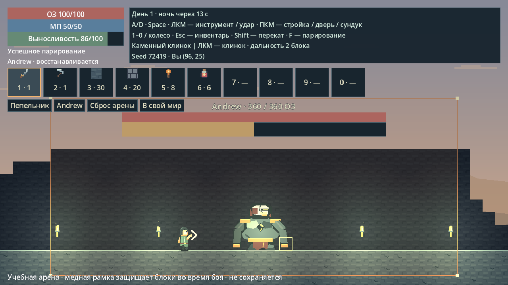

# Боевой прототип: 2D soulslike-песочница

Godot 4.6.3 Standard подходит для выбранного направления. Проект продолжает существующую игру: разрушение мира, добыча, крафт, строительство, исследование, кооператив и сохранения остаются. Новый приоритет — бой и движение; расширение крафта, биомов и декора отложено.

Свобода песочницы сочетается с мрачной атмосферой и боем на дистанции и таймингах. Terraria, Blasphemous и детализация окружения Kyora служат ориентирами; персонажи, история, символы и графика проекта собственные. Боевая арена не является новым игровым миром или началом проекта заново.

## Как открыть и проверить

1. Импортируйте `project.godot`, запустите **F5**.
2. Нажмите **«Проверка боя»** справа под сохранением. Игра сначала сохраняет обычный мир. Если сохранение не удалось, переход отменяется; если вы в кооперативе, сначала выйдите из сетевой сессии.
3. Откроется отдельная временная арена с клинком, киркой, материалами и бальзамом. Один пепельник уже на площадке.
4. **«Пепельник»** создаёт следующего обычного врага, когда предыдущий побеждён. **«Andrew»** начинает свежий тест босса. **«Сброс арены»** восстанавливает площадку, здоровье и тестовые предметы. **«В свой мир»** возвращает исходный сохранённый мир.

Арену также можно открыть в Godot как `scenes/combat_arena.tscn` и нажать **F6**, либо запустить:

```sh
godot --path . res://scenes/combat_arena.tscn
```

Арена не читает и не блокирует игровой профиль, не загружает и не записывает сохранение. Её тестовые вещи не переносятся в обычный мир. Во время настоящей смерти на арене действуют прежние сундук и дух; только явный сброс очищает этот временный стенд. Сохранение/загрузка и сетевые кнопки на стенде отключены. Обычный мир по F5 продолжает использовать прежнее сохранение.



## Управление

| Ввод | Действие |
| --- | --- |
| A / D, Space | Прежние движение и прыжок |
| ЛКМ с клинком | Подготовка → удар → восстановление; направление мышью |
| Shift | Перекат по удерживаемому A/D; без направления — по взгляду |
| F | Парирование перед собой, отдельное нажатие |
| ПКМ, 1–0, колесо, Esc | Прежние строительство, выбор слота и инвентарь |

Текстовые поля и открытый инвентарь не запускают новые боевые действия. Ходьба и добыча выносливость не расходуют. Начатый удар завершается после отпускания ЛКМ; удержание ЛКМ повторяет удар только после полного восстановления. В первом прототипе удар, перекат и парирование не отменяют друг друга. Их нельзя начать при недостатке выносливости.

Красная полоса — ОЗ, синяя — мана, зелёная — выносливость. Стойкость босса находится в отдельном общем интерфейсе; это не выносливость игрока. Полосы босса перенесены выше персонажей, чтобы не закрывать приготовления и попадания.

## Начальные настройки

Все новые значения находятся в `data/battle.gd`; прежние параметры здоровья, суток и восстановления ресурсов — в `data/combat_rules.gd`, исходные атаки Andrew — в `data/bosses.gd`.

| Действие | Тайминги | Стоимость / результат |
| --- | --- | --- |
| Каменный клинок | 0,12 с подготовка, 0,10 с активный удар, 0,25 с восстановление | 18 выносливости, 24 урона, 18 урона стойкости, дальность 32 px (2 блока) |
| Перекат | 0,44 с; неуязвимость только от 0,05 до 0,27 с | 24 выносливости, скорость 225 px/с |
| Парирование | Всего 0,58 с; успешное окно от 0,04 до 0,18 с | 14 выносливости; после успеха 0,18 с восстановления |
| Пепельник | 0,48 с подготовка, 0,12 с удар, 0,68 с восстановление | Прежние 14 урона днём / 22 ночью; после парирования оглушён на 1 с |
| Удар Andrew о землю | 0,12 с фаза приземления, попадание через 0,04 с после её начала | Прежние 34 урона; парирование снимает 45 стойкости |

Один взмах поражает каждую цель максимум один раз и не проходит через твёрдую преграду. Обычный пепельник по прежнему имеет базовые 45 ОЗ: теперь одиночный враг погибает от двух попаданий клинка. Его здоровье ради затягивания боя не увеличивалось. Удар тратит ресурс один раз при начале и замедляет перемещение до 45% обычной скорости.

Пепельник больше не наносит урон простым касанием. Он останавливается, фиксирует сторону, сжимает панцирь и показывает тёплый знак перед атакой. Светлый знак означает активную фазу. После промаха остаётся время на ответный удар; попадание игрока сбивает его подготовку. Контактный урон духа сохранён, перекат позволяет его избежать.

При неудачном парировании персонаж остаётся уязвим и восстанавливается до конца действия: повторное нажатие не перезапускает окно. Для обычных ударов нужно смотреть на противника. Радиальный удар Andrew о землю парируется независимо от стороны. Успех отменяет попадание, прерывает текущую атаку и создаёт окно для ответа. Парирование само по себе не снимает здоровье босса.

После полученного урона сохранена защита на 0,9 с; короткое восстановление управления — 0,18 с. Это оставляет возможность выйти из опасности вместо неизбежной цепочки ударов. Восстановление выносливости прежнее: задержка 0,8 с, затем 28 единиц/с, без автоматического лечения ОЗ.

## Andrew и момент приземления

Сохранены текущая внешность, обычное появление после трёх пепельников, апперкот, отскок, вертушка, прыжок, общие полосы ОЗ/стойкости и оглушение ровно на 2 секунды. В тестовом стенде кнопка Andrew лишь сокращает подготовку к проверке; обычная прогрессия не заменена кнопкой.

Красный прямоугольник предупреждает, куда босс собирается прыгнуть. Он **не является окном парирования**. Подготовка длится 1,25 с, полёт — около 0,9 с; короткое окно F должно встретить именно попадание после приземления. Если нажать F в начале красной подготовки, защита успеет закончиться.

При приземлении появляется отдельный светлый штрих; попадание наступает через 0,04 с. Ориентируйтесь на завершение полёта. Успешное парирование снимает 45 из 90 единиц стойкости, не снимает ОЗ и отменяет этот удар. Два успешных парирования без других изменений стойкости дают двухсекундное оглушение. Перекат тоже спасает, если его короткая неуязвимость совпала с попаданием.

## Защита арены и прежние правила

Во время боя медная рамка обозначает область, в которой нельзя добывать/ставить блоки, стены, факелы, двери и сундуки, снимать мебель и рубить деревья. Вне рамки обычный мир остаётся доступным для изменения. В учебной сцене перед свежей попыткой босса восстанавливается авторская площадка: нельзя подготовить яму или стену и затем запустить тест. Обычная камера мира остаётся следящей; учебная камера показывает площадку целиком.

В обычном мире для текущего боя выделяется небольшая локальная область около босса, максимум 25×16 клеток, без переделки рельефа. Она не растягивается до удалённых товарищей. Ограничения снимаются после окончания боя. Босс остаётся в пределах области; если все живые игроки покидают её, бой прекращается. Прежнее завершение при смерти участника сохранено; участником считается игрок, вошедший в область боя. Учебный сброс позволяет сразу повторить попытку. Обычный Andrew по прежнему появляется один раз за запуск.

Здоровье рассчитывается прежней общей функцией: `ceil(base × (1 + 0.25 × (players − 1)))`. Считаются все подключённые игроки текущего мира, включая временно погибших, даже если они далеко от арены. Обычный враг фиксирует число игроков при появлении, босс — при начале боя. Подключения/отключения не пересчитывают живого противника. Урон, скорость и стойкость этим множителем не меняются.

Смерть оставляет весь инвентарь в сундуке; возрождение возвращает персонажа без снаряжения. При разрушении сундука появляется дух на два успешных удара, с радиусом 10 блоков от исходного места. Один взмах, открывший сундук, не может одновременно ударить его нового духа. Формат сохранений и старые миры поддерживаются. Активные окна атаки, переката и парирования не сохраняются: загрузка возвращает нейтральное действие.

## Проверки и следующие решения

`tests/battle_smoke.gd` проверяет фазы/дальность/однократный урон, расход, защитные окна, неудачное и раннее парирование, удар со спины, обычного врага, приземление Andrew, стойкость/оглушение, локальность запрета строительства, сундук/духа, безопасную загрузку и изоляцию арены.

`python tests/run_battle_network.py` использует существующую ENet-сеть: хост и два клиента проверяют расход, перекат/парирование и фазовый урон. Это не новая полная реализация мультиплеера. Подсчёт и попадания выполняет хост; клиенты не задают ОЗ, выносливость или длительность неуязвимости. Предсказания/rollback и подстройки окон под высокий ping нет. Всем участникам нужна одна новая версия.

В графическом Godot проверены Shift/F/ЛКМ, перемещение и остановка переката, активный удар, красное предупреждение и парирование приземления. Автоматика проверяет правила, а не удовольствие от боя. Вам остаётся оценить отзывчивость, дистанцию, читаемость приготовления и анимации, окно F, строгость ошибок и баланс; отдельно — LAN между разными ПК и четыре живых игрока.

Ограничения первого прототипа: один клинок, один обычный враг, без комбо/буфера ввода/отмен действий/воздушного переката/подбора экипировки на арене. Перекат сохраняет физический размер персонажа и не предназначен для низких проходов. Мана есть, заклинаний нет. После отзыва сначала корректируем бой, затем возвращаемся к развитию песочницы.

Переход через настоящую кнопку в арену и обратно покрыт ещё 5 проверками в `tests/arena_transition_smoke.gd`, запущенными из `run_save_restart.py`: исходный файл не меняется, блоки/инвентарь возвращаются, тестовый лут не переносится, блокировка того же профиля вновь получается.
