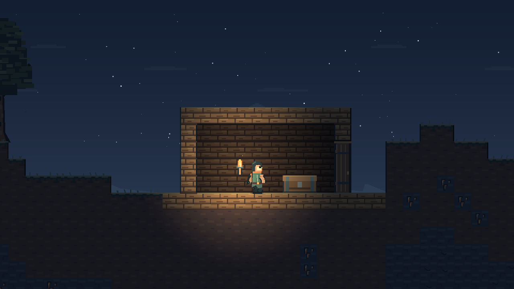

# Тлеющая глубина — визуальное направление Emberdepths

Первый цельный авторский проход по уже существующей игре. Основа — холодный сланец, окисленная медь, костяной свет и тёплые искры. Общий мотив — расколотый ромб: застёжка героя, подвеска Andrew, знак сундука смерти и расходящиеся эффекты.



[Текущее превью анимаций в 60 FPS](fluid-motion.mp4) · [описание нового прохода](ANIMATION.md)

[Ранний обзор поз героя и фаз Andrew](motion-preview.gif)

## Характеры и движение

Герой — странник в асимметричном дорожном костюме: складчатый капюшон, светлая полумаска, медная застёжка и два хвоста шарфа. Ткань слегка запаздывает за телом. После смерти одежда по прежним правилам исчезает; голова и тело остаются читаемыми. Новый образ не добавляет предметов экипировки.

У шага есть опора и перенос ноги, у прыжка — разные позы взлёта и падения, у приземления — короткое сжатие и пыль. Удары и инструменты проходят через подготовку, быстрый взмах и завершение. Кирка и топор различаются формой и жестом; строительство показывает короткое движение руки. Лечение поднимает флакон, здоровье отмечается частицами и числом.

Пепельники — угольные существа с треснувшим панцирем и тёплой щелью вместо глаз: при движении панцирь переносит вес. Дух — светлая маска с раздельными полупрозрачными лентами, которые отстают от направления полёта. У Andrew сохранены массивное телосложение и длинные волосы; добавлены светлая полумаска, медные обручи и расколотая подвеска. Позы различают подготовку апперкота, удар, вращение, отскок, прыжок, приземление и оглушение. Опасные зоны остаются поверх окружения и совпадают с прежней геометрией урона.

Гибель рассыпается на пиксельные частицы; возрождение и лечение используют разорванные ромбические кольца. Новые эффекты не дают защиты, урона или предметов.

## Мир и предметы

- Собственный SVG-атлас земли и сланца, мягкие цветовые плоскости вместо сильного шума; края открытых блоков выделены светом и тенью. Искрокамень выглядит как жила в камне.
- На дёрне — редкие травинки; ветви и листья двигаются с разными фазами. Несколько опадающих листьев считаются без отдельных узлов. Падение срубленного дерева длится одну секунду, добыча по прежним правилам появляется сразу.
- Слоистый дальний рельеф, медленные полосы облаков, солнце, луна и звёзды следуют одному `combat.world_time`. Камера не меняет небесную орбиту.
- Факел имеет отдельные пиксельные языки пламени, искры и несинхронное слабое мерцание. Мебель открывается с плавным ускорением/замедлением; петли двери стоят на месте, замок сундука следует за крышкой.
- Выпавшие предметы немного покачиваются и изредка бликуют. Физические позиции и радиус подбора не меняются.
- Интерфейс использует сланцевые панели, медные границы и мягкое появление инвентаря. Положение элементов и управление сохранены.

## Технические границы

`art_direction.gd` задаёт палитру и тему, `action_pose.gd` — фазовую кривую жеста. `player_pose.gd` / `andrew_pose.gd` отвечают за позы, `enemy_art.gd` / `andrew_art.gd` — за рисунок. Это процедурная пиксельная графика: не готовый набор покадровых спрайтов. Её можно развивать или позже заменить спрайтами, сохранив состояния действий.

Физические тела, размеры коллизий, длительности атак, здоровье, стоимость выносливости и сохранённые данные не зависят от рисунка. Жест добычи/строительства имеет отдельный косметический таймер и не задерживает лечение. В кооперативе хост передаёт только событие жеста через authority-only RPC; потеря такого пакета не влияет на добычу. Всем участникам нужна новая версия проекта.

Частицы рисует один Node2D: максимум 256 частиц и 16 колец, без отдельного узла на искру. Для поверхностных деталей обрабатывается только видимая область. Новых библиотек, шейдерных зависимостей и сторонних ассетов нет. Атлас, рисунки и эффекты созданы для проекта. Источник прежнего звука листвы остаётся в `assets/audio/README.md`; новых звуков этот проход не добавляет.

## Как посмотреть

В Godot импортируйте `project.godot` и нажмите F5. Пройдите и развернитесь A/D, прыгните Space; добудьте блок пустой рукой и киркой, срубите дерево топором, взмахните клинком, постройте блок. Проверьте бальзам после получения урона, смерть/возрождение, дверь, сундук и факел ночью. Для Andrew по прежним правилам нужно победить трёх пепельников. Его предупреждения и баланс не изменялись.

Обзор поз можно воспроизвести отдельным графическим запуском:

```sh
godot --path . --script tools/render_motion_gallery.gd
```

Кадры сохраняются в `user://motion-review/`. Другой путь можно передать как `-- --out=/tmp/ember-motion`. Этот стенд не запускает игровой мир и не изменяет игровые сохранения; он не является меню или читом внутри игры. GIF в документации собран FFmpeg из кадров настоящего Godot, 15 кадров/с; сама игра анимируется с частотой отрисовки.

Проверки: `tests/visuals_smoke.gd` (27), прежние проверки игры и сетевые сценарии. Графический стенд покрывает фазы поз; дополнительно проверены реальные ходьба/прыжок/бой в сцене и клики по мебели. На машине без монитора использованы Xorg dummy и OpenGL/Mesa. Это не заменяет оценку ощущения игры и LAN между разными ПК. Качество рисунка и движения дальше стоит уточнять по игровому отзыву, до добавления новых крупных систем.


## Второй проход: переходы и инерция

Рука теперь начинает и заканчивает каждое действие в одной нейтральной позе: отдельный `action_pose.gd` рассчитывает завершённый жест клинка, кулака, кирки, топора и строительства. Запястье и инструмент двигаются вместе; клинок получил сколотый силуэт и светлую грань. Наклон рисунка закреплён у стоп, не у центра тела. Флакон после применения плавно опускается; это не продлевает применение, расход или задержку бальзама.

У ткани появился ограниченный пружинный отклик (`cloth_motion.gd`) с небольшими подшагами, у разворота — короткая смена силуэта через боковую позу. Физическое направление героя меняется сразу. Контактная тень не рисуется в полёте; у удалённого персонажа нулевая вертикальная скорость дополнительно проверяется по опоре, чтобы вершина прыжка не превращалась в позу стояния.

Andrew делает один читаемый оборот вертушки вместо двух быстрых сжатий; при повороте видны затылок и спина. Зона урона, длительность и правила атаки не меняются.

[Замедленный обзор действий героя](action-preview.gif). Воспроизведение: `godot --path . --script tools/render_action_gallery.gd`; кадры по умолчанию в `user://action-review/`. Этот обзор специально замедляет жесты для просмотра поз; реальные игровые длительности прежние.

Обновление окружения (2026-11-05): собственный атлас листвы `assets/canopy.png`, 12 вариантов, CC0-1.0; генератор `tools/build_canopy_atlas.py`. Крупные связанные листовые массы со светлыми краями, тёмной нижней частью и мягкими медными стволами. Грунт менее шумный, у уступов мох, камень имеет слоистые плоскости. Холодный верх неба и силуэты разрушенных пролётов углубляют дальний план. Всё декоративное, коллизии/предметы прежние. [День](visual-day.png), [ночь](visual-night.png), [производительность и ограничения](PERFORMANCE.md).

Andrew (2026-11-06): прежняя каменная трактовка заменена цельным человеческим силуэтом — светлая кожа, мускулатура, большой живот, длинные волосы, видимая квадратная челюсть. Задняя рука с кистью рисуется за туловищем, передняя — поверх; стыки закрыты заполненными суставами. [Позы](andrew-anatomy.png), [отражение](andrew-mirrored.png), [новые области](WORLD_EXPANSION.md).
